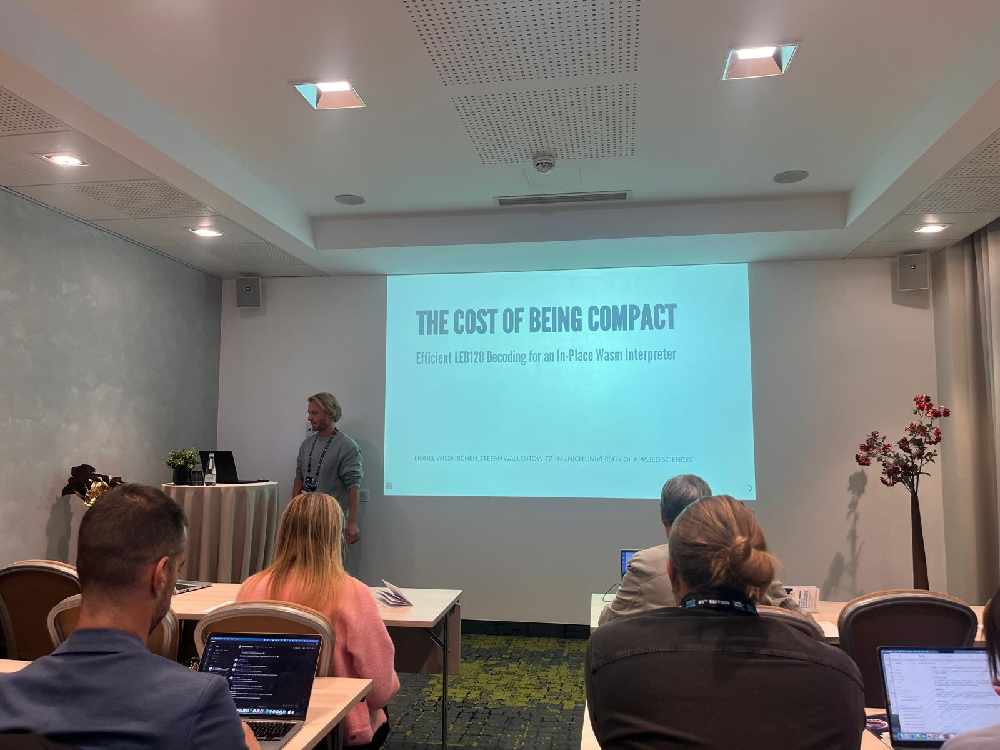
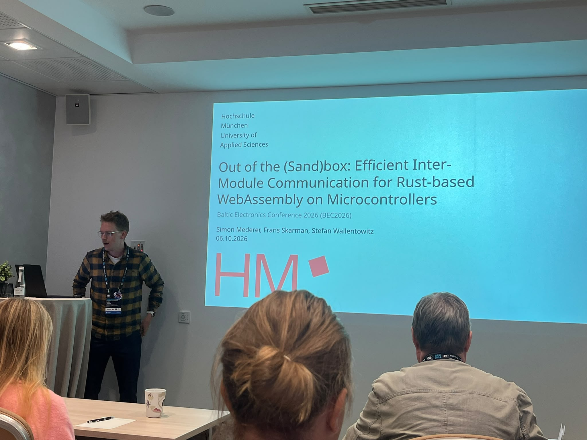
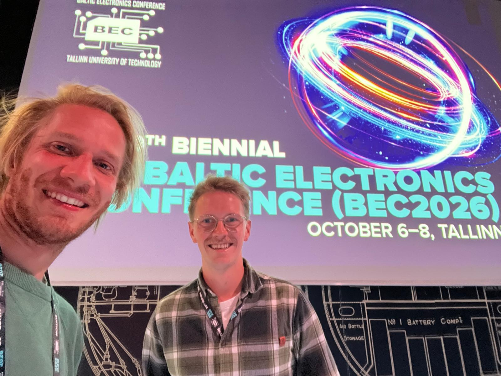

In October 2026 the 20th **Baltic Electronics Conference (BEC 2026)** took place in Tallinn, Estonia. We presented two papers about WebAssembly in embedded systems.

First, Lionel Wisskirchen presented his paper *The Cost of Being Compact: Efficient LEB128 Decoding for an In-Place WebAssembly Interpreter*, in which he examines performance optimizations for the WebAssembly runtime **TWEED**, which was developed as part of his masters degree. A primary focus of the paper was the analysis of the use of LEB128-encoded integers in real WebAssembly binaries and their impact on binary size. In addition, optimizations to the decoding algorithm for LEB128 values were implemented in **TWEED** and evaluated.  

The second presentation, given by Simon Mederer, was about his paper *Out of the (Sand)box: Efficient Inter-Module Communication for Rust-based WebAssembly on Microcontrollers*. In this paper he implemented and evaluated multiple mechanisms for efficiently exchanging data between WebAssembly modules, which is crucial when using resource-constraint devices such as microcontrollers. Those inter-module communications methods were evaluated regarding throughput, memory consumption and data-security.  

  
   

   

Tallinn is a truly impressive city. Although its Old Town has been a UNESCO World Heritage Site since 1997, the city also stands out for its modern infrastructure. The best part, however, is the genuine warmth and friendliness of the locals, which make Tallinn a very nice place to be.

As this conference was specifically aimed at PhD students, it was an excellent opportunity to exchange with colleagues from all over the world. It's always interesting and motivating to see projects from other PhD students and share new ideas.

Both publications can be found at our [publication page](https://aemy.cs.hm.edu/publications).
