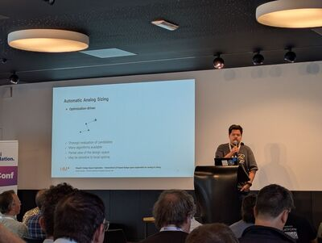
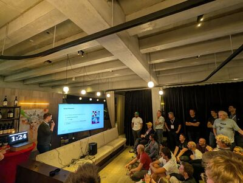
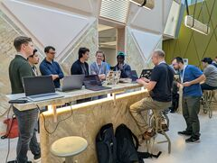

Members of our research group attended [ORConf 2026](https://fossi-foundation.org/orconf/2026) in Ghent,
Belgium, from Friday, September 11 to Sunday, September 13, 2026.

## ORConf

ORConf is an annual conference for the open-source silicon community, where participants gather for presentations and networking.
The event is organized by the FOSSi Foundation.
This year's conference took place at the Zebrastraat event center.

Members of our group were part of the program with several contributions.

## Our Contributions to the Event

Daniel Arevalos-Ortiz, Christopher Hinz, Patrick Kirschke,
Tobias Wölfel, Dr. Frans Skarman and Prof. Dr. Stefan Wallentowitz represented our research group at the event and contributed two talks and two lightning talks, as well as a small workshop on the Spade HDL.

### Talks

#### Things to Make and Do With the Spade HDL (Dr. Frans Skarman)

Frans gave a talk about what can be built with one of his main projects, the [Spade HDL](https://spade-lang.org/).
Spade is inspired by modern software languages and provides a modern type system, first-class pipelines and zero-cost abstractions.
He led the audience through a range of projects written in Spade: from processors, to an Ethernet core and a camera interface he built to go fish watching with a submarine, to less serious projects like an RTL UI library, which ran his slides directly from an FPGA.

[Watch the full talk.](https://youtu.be/PEPsO_Q_tCA)

#### ShapeIC: LUT-Based Hierarchical Exploration for Analog IC Design (Daniel Arevalos-Ortiz)

Daniel presented his most recent work on his open-source project ShapeIC, a tool for design-space exploration in analog IC sizing.
He introduced the basic ShapeIC flow and some of the challenges that appear when LUT-based exploration is applied to real transistor sizing.

[Watch the full talk.](https://youtu.be/0YLB8wuWlx0)

  

### Lightning Talks

With only two minutes on the clock, two members of our group took up the challenge of presenting their work within this short time frame.
The lightning talks took place on Saturday night during a social event at the SGOL grand café.

- **No SystemVerilog Required: Connecting CIRCT with Yosys and Verilator**:
  Tobias teased the concept of CIRCT, which can be used to connect the tools of the chip design flow without the need to work with SystemVerilog.
  [Watch the lightning talk.](https://youtu.be/O2XNPJ7DRjQ?t=109)
- **QSPI memory for indecisive people**:
  Christopher showed his work on a QSPI controller, which he developed for the hatch SoC platform used for teaching and research in our team.
  [Watch the lightning talk.](https://youtu.be/O2XNPJ7DRjQ?t=333)

  

### Spade Workshop

On Sunday, the last day of the conference, anyone could suggest a workshop topic and work on it with interested participants.
Frans offered a short introduction to the Spade HDL. He explained the basic concepts of the language and showed how to get a simple design running on an FPGA he had brought along.

  

## Beyond the Talks

ORConf was a great opportunity to connect with people who build and use the same tools as we do. It once again showed us how lively the open-source community is.

If you have ideas for any of the presented projects, or would like to work with us, get in touch or have a look at our [open positions](/open-positions/).

Directly after the conference, the members of our group who are part of the ODE4EC project stayed in Ghent for the first regular
meeting of this project. You can read more about it in
[our post on the ODE4EC meeting]().
