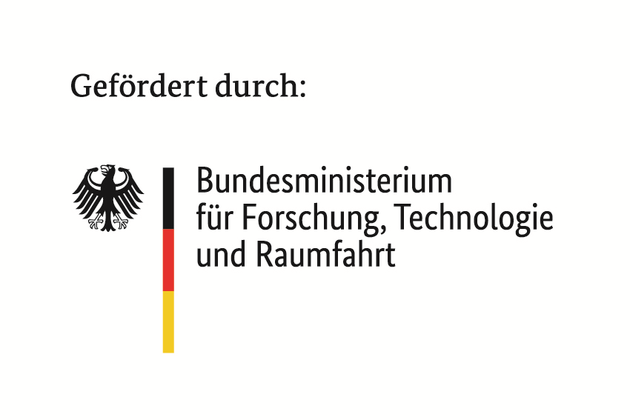

Our team is a partner in the research project *Open Design Methodology for the
Standardization and Automation of IP Integration in Chip Architectures
(DI-FITS)*. FITS stands for formal IP integration specification and automation.
The project is funded by the German Federal Ministry of Research, Technology and
Space (BMFTR) in the [DE:Sign Challenge](https://www.elektronikforschung.de/foerderung/bekanntmachungen/design)
program for open source chip design tools (grant 16ME1167, February 2026 to
January 2029). FZI Forschungszentrum Informatik coordinates the project, and the
other partners are Technical University of Munich and Infineon.

Reusing semiconductor IP blocks is often harder than it should be, because their
interfaces rarely match. FITS defines a specification format, *FITS-IR*, that
describes an IP block's interfaces, parameters and behavior. Open source tools
built on FITS-IR check whether IP blocks are compatible and generate the adapters
that connect them automatically.

HM-AEMY leads three work areas:

- Adapter-based integration of IP blocks
- Automated white-box analysis, which derives FITS-IR descriptions from existing
  RTL code
- Validation with demonstrators, tutorials, and the open source release of the
  project results

All results of the project will be open source.

  

