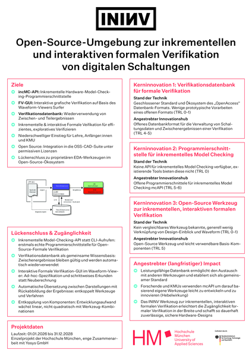
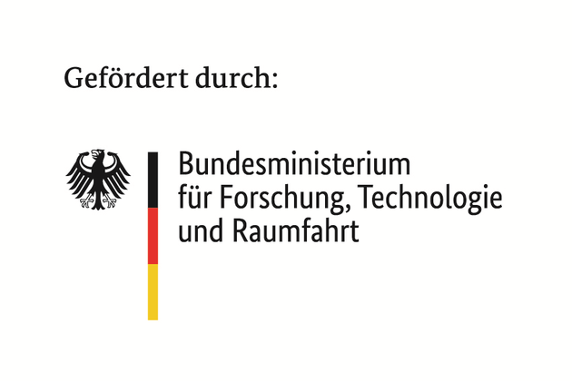

Our team leads the research project *Interactive Open Source Interface for the
Formal Verification of Chip Designs (DI-ININV)*. ININV stands for incremental and
interactive formal verification. The project is funded by the German Federal
Ministry of Research, Technology and Space (BMFTR) in the
[DE:Sign Challenge](https://www.elektronikforschung.de/foerderung/bekanntmachungen/design)
program for open source chip design tools (grant 16ME1165, January 2026 to
December 2028).

Formal verification can find bugs that simulation misses, but open source tools
for it are still hard to use, especially for newcomers. ININV makes formal
verification incremental and interactive:

- A data model for a verification database that stores and reuses verification
  results
- An incremental model-checking API built on that database
- An interactive formal verification interface integrated into the open source
  waveform viewer [Surfer](https://surfer-project.org/)
- Evaluation of the tools and dissemination of the results

The results will be released as open source and are planned to become part of
the [OSS CAD Suite](https://github.com/YosysHQ/oss-cad-suite-build).

  

