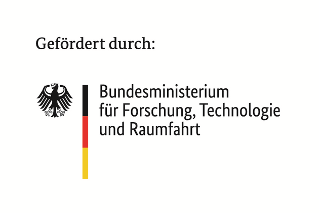

Our team takes part in two projects of the *Open Design Environment for European
Chips* ([ODE4EC](https://ode4ec.eu/)) initiative. Both are funded by the
European Union through the Chips Joint Undertaking (Horizon Europe) and by the
German Federal Ministry of Research, Technology and Space (BMFTR), and both run
from June 2026 to May 2029. Together, the ODE4EC projects advance open source
tools for chip design, so that European companies, startups and universities
depend less on proprietary tools.

Read about the first ODE4EC meeting in our post
[ODE4EC Meeting September 2026]().

## ODE4EC-PIV: Productivity, Interoperability, Verification

ODE4EC-PIV develops the next generation of open source EDA tools for design
productivity, interoperability and scalable verification. The work covers
modular design entry, formal and scenario-based verification, waveform analysis
and AI-assisted tools. The project is coordinated by INESC TEC (BMFTR grant
16MEE1114K).

HM-AEMY leads the work package *Modular Frameworks for Design Entry and Flow
Integration*. Our contributions center on the
[Spade hardware description language](https://spade-lang.org/), the
[CIRCT framework](https://circt.llvm.org), tool flow integration, and the
waveform viewer [Surfer](https://surfer-project.org/).

## ODE4EC-DIG: Digital SoC Design

ODE4EC-DIG builds open source tools for designing digital systems-on-chip, from
design entry to physical integration, and validates them on real tape-outs. The
project is coordinated by Politecnico di Milano (BMFTR grant 16MEE1153K).

HM-AEMY contributes to two tools:

- The open source chip design flow
  [LibreLane](https://github.com/librelane/librelane), with incremental builds,
  better reporting and improved stability
- The [CIRCT framework](https://circt.llvm.org), with inference of arithmetic
  and DSP blocks

We also lead the project's tasks on coordination across work streams,
communication and dissemination, and community building.

  

