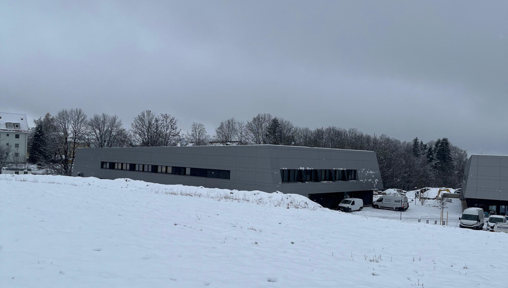

We are part of the newly founded [TIZIO (Transfer- und Innovationszentrum im Oberland)](https://hm.edu/kooperationen_transfer/tizio/index.de.html) based in Bad Tölz. There we have the [lab for IoT-Prototyping](https://hm.edu/kooperationen_transfer/tizio/labor_iot.de.html). 

In this lab, we work on solutions related to:

- Digitization of production
- IT security & zero-trust environment
- Embedded systems 

We also investigate concepts such as WebAssembly for embedded systems. As part of this, we are 
developing TWEED,  an efficient in-place interpreter that executes WebAssembly bytecode directly, 
without first converting it into an intermediate representation. The current state can be found in 
[TWEED](https://github.com/lionelwisskirchen/tweed).