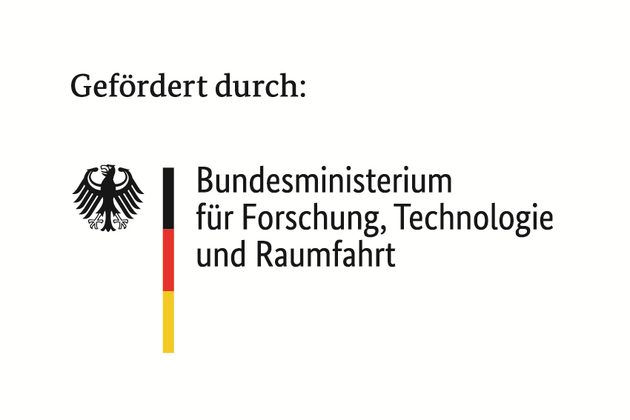

Our team is involved in the research project *Open Chip Design Challenge
prototype (OCDCpro)* which is funded by the German Federal Ministry of Education and Research
(BMBF, now BMFTR) under grant 16ME0939 in its DE:Sign
[open source EDA software program](https://www.elektronikforschung.de/foerderung/bekanntmachungen/design).
The project runs from May 2024 to April 2027.

  

