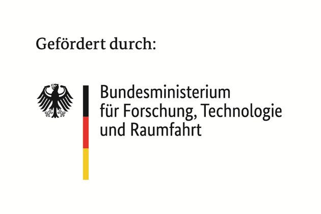

Our team is a partner in the research project *ODE4EC-PIV: Productivity,
Interoperability, Verification*, coordinated by INESC TEC (BMFTR grant
16MEE1114K). It is part of the *Open Design Environment for European Chips*
([ODE4EC](https://ode4ec.eu/)) initiative, which advances open source tools for
chip design so that European companies, startups and universities depend less
on proprietary tools. The project is funded by the European Union through the
Chips Joint Undertaking (Horizon Europe) and by the German Federal Ministry of
Research, Technology and Space (BMFTR), and runs from June 2026 to May 2029.

ODE4EC-PIV develops the next generation of open source EDA tools for design
productivity, interoperability and scalable verification. The work covers
modular design entry, formal and scenario-based verification, waveform analysis
and AI-assisted tools.

HM-AEMY leads the work package *Modular Frameworks for Design Entry and Flow
Integration*. Our contributions center on the
[Spade hardware description language](https://spade-lang.org/), the
[CIRCT framework](https://circt.llvm.org), tool flow integration, and the
waveform viewer [Surfer](https://surfer-project.org/).

Read about the first ODE4EC meeting in our post
[ODE4EC Meeting September 2026](/2026/10/14/ODE4EC-2026.html).

  
  
  

